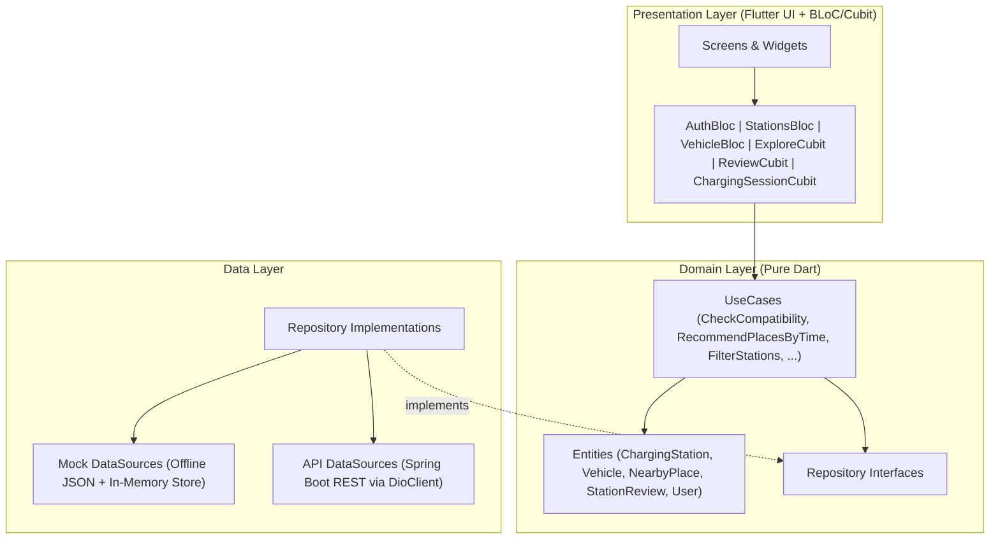

# ChargeMate — Smart EV Charging Station Finder & Explore Platform

**ChargeMate** is a cross-platform mobile application built with **Flutter** and **Clean Architecture (BLoC / Cubit)** designed for Sri Lanka's growing Electric Vehicle (EV) ecosystem. Beyond locating charging stations and verifying plug-level compatibility, ChargeMate introduces **Charge & Explore**—an intelligent time-budgeted recommendation engine that matches a driver's charging duration (e.g., 20% → 80% SoC) with walkable nearby cafés, dining, shopping, and cultural sights.

---

## Key Features & Modules

### 1. Authentication & Driver Profile (`lib/features/auth/`, `lib/features/profile/`)
- **JWT Authentication Flow**: Login, Registration, Password Reset, and persistent sessions backed by `FlutterSecureStorage` and a Dio `AuthInterceptor`.
- **1-Tap Demo Mode**: Pre-configured demo credentials (`demo@chargemate.lk` / `demo1234`) for instant offline/live interview evaluation.
- **Driver Profile & Favourites**: Edit profile details and manage bookmarked stations across Sri Lanka.

### 2. EV Charging Station Finder & Dark Cartography (`lib/features/station/`)
- **Sri Lanka Station Dataset**: 18 real-world charging hubs across Colombo, Kandy, Galle, Negombo, Kurunegala, Nuwara Eliya, and the Southern Expressway (`chargeNET`, `Lanka EV`, `CEB`, `Vega Charge`).
- **Interactive Dark Map**: Built on `flutter_map` with high-contrast **CARTO Dark** OpenStreetMap tiles (`dark_all`), custom power-rated station markers, and an animated user location beacon.
- **Multi-Criteria Filtering**: Filter by connector standard (`CCS2`, `CHAdeMO`, `Type 2`, `Type 1`, `GB/T`), charging speed (`22 kW+`, `50 kW+`, `100 kW+`), network, 24/7 hours, and operational status.
- **Optimistic Local-First Startup**: Renders cached Colombo stations in `<50ms` while refreshing GPS coordinates asynchronously in the background.

### 3. Vehicle Management & Compatibility Engine (`lib/features/vehicle/`)
- **Verified EV Specification Catalog**: 17 popular EV models in Sri Lanka (Nissan Leaf, BYD Atto 3 / Dolphin / Seal, MG ZS EV / MG4, Hyundai Kona / Ioniq 5, Tesla Model 3 / Y, Kia EV6, BMW iX3, etc.).
- **Plug & Rate Negotiation (`CheckCompatibilityUseCase`)**:
  - Matches vehicle connector standards against station charging points.
  - Computes real-world negotiated charging power: $\text{Effective kW} = \min(\text{Charger kW}, \text{Vehicle Max kW})$.
  - Estimates **20% → 80% charging duration** (accounting for DC taper / AC efficiency) and **session cost in LKR**.

### 4. Charge & Explore — Time-Budgeted Nearby Discovery (`lib/features/explore/`)
- **Smart Time-Window Matching (`RecommendPlacesByTimeUseCase`)**:
  - Automatically pre-fills the time budget slider using either the active charging session's remaining minutes or the primary EV's 20% → 80% charging estimate.
  - Calculates total round-trip time for every nearby venue:
    $$\text{Total Time Required} = (2 \times \text{Walking Minutes}) + \text{Average Visit Minutes}$$
  - Badges each venue as **"Fits in Xm"** (emerald) or **"Tight for Xm"** (amber).
- **Dual Discovery Modes**: Toggle between a categorized **Places List** (`Food & Coffee`, `Shopping`, `Entertainment`, `Tourism`) and a **Walking Radius Map** displaying a 400m (~5 min walk) radius circle and 1-tap walking directions.

### 5. Live Charging Session Telemetry Simulator (`lib/features/session/`)
- **Real-Time Session Banner & Controls (`ChargingSessionCubit`)**:
  - Start a simulated charging session on any station detail page.
  - Tracks live **Battery SoC %** (`20% → 80%`), **Energy Added (kWh)**, **Live Cost (LKR)**, and **Remaining Time (min)**.
  - Includes a **`+5m Demo` fast-forward button** for live demonstrations and a 1-tap **"Explore Places for Your X min Wait"** action.

### 6. Community Status Reporting & Driver Reviews (`lib/features/review/`)
- **Crowdsourced Status Verification**: Drivers can verify or report station status (**Working**, **Issues Reported**, **Offline**) in 1 tap, updating `StationsBloc` across the app immediately.
- **EV-Tagged Reviews**: Submit star ratings and comments automatically badged with the driver's primary EV model.

---

## Architecture & Tech Stack

ChargeMate follows **Feature-First Clean Architecture** with strict separation between `domain`, `data`, and `presentation` layers:



| Category | Technology |
| :--- | :--- |
| **Framework & Language** | Flutter 3.x, Dart 3 |
| **State Management** | `flutter_bloc` (`Bloc` & `Cubit`), `equatable` |
| **Dependency Injection** | `get_it` (`lib/injection.dart` with `useMockBackend` toggle) |
| **Navigation** | `go_router` (`StatefulShellRoute.indexedStack` + auth redirect guard) |
| **Networking & Auth** | `dio`, `flutter_secure_storage`, `shared_preferences` |
| **Maps & Geolocation** | `flutter_map` (CARTO Dark tiles), `latlong2`, `geolocator`, `url_launcher` |
| **Typography & Theme** | `Space Grotesk`, `Plus Jakarta Sans`, `JetBrains Mono` (`google_fonts`) |
| **Functional Error Handling** | `dartz` (`Either<Failure, T>`) |

---

## Color System & Accessibility

Designed around automotive-grade dark interfaces (inspired by ChargePoint, PlugShare, and Rivian):
- **Obsidian Slate Background (`#090D16`) & Elevated Surface (`#111827`)**: Reduces OLED battery consumption and minimizes night-driving glare.
- **Electric Cyan (`#00D4FF`) & Indigo (`#6366F1`)**: Primary interactive accents and route highlights.
- **Semantic Status Triad (WCAG 2.1 AA Dual-Indicator)**:
  - **Operational / Available**: Emerald (`#10B981`) + Check Icon + Label
  - **Explore / Warning**: Solar Amber (`#F59E0B`) + Warning/Explore Icon + Label
  - **Offline / Faulted**: Crimson (`#EF4444`) + Alert Icon + Label

---

## Getting Started

### Prerequisites
- Flutter SDK `>=3.4.0`
- Android Studio / Android Emulator (or physical Android/iOS device)

### Run the App
```bash
# 1. Install dependencies
flutter pub get

# 2. Run static analysis
flutter analyze --no-pub

# 3. Run unit tests
flutter test

# 4. Launch on Android Emulator
flutter run -d emulator-5554
```

### Switching Between Offline Demo Mode & Spring Boot Backend
In [`lib/injection.dart`](lib/injection.dart):
```dart
/// Set to `false` once the Spring Boot backend is running on http://10.0.2.2:8080/api
const bool useMockBackend = true;
```
When `useMockBackend = true`, the app runs 100% self-contained using bundled Sri Lankan JSON datasets (`assets/mock_data/`) and local persistence.
